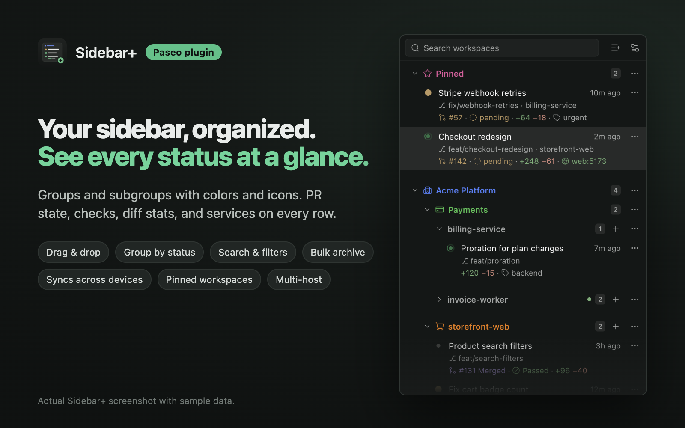
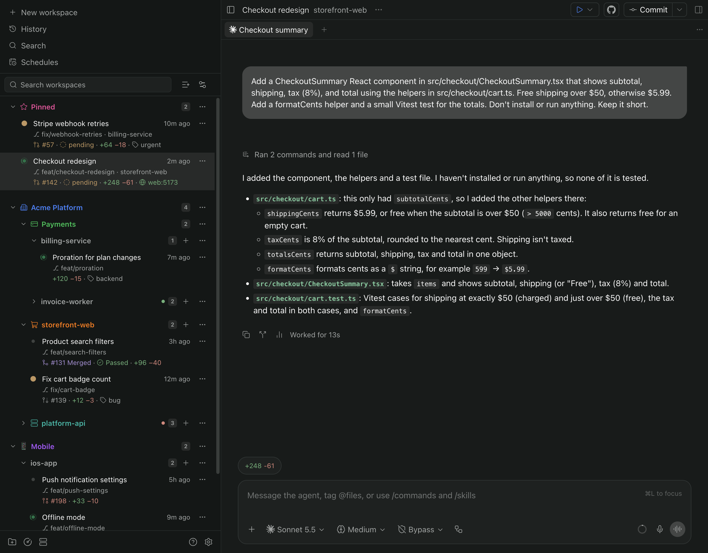
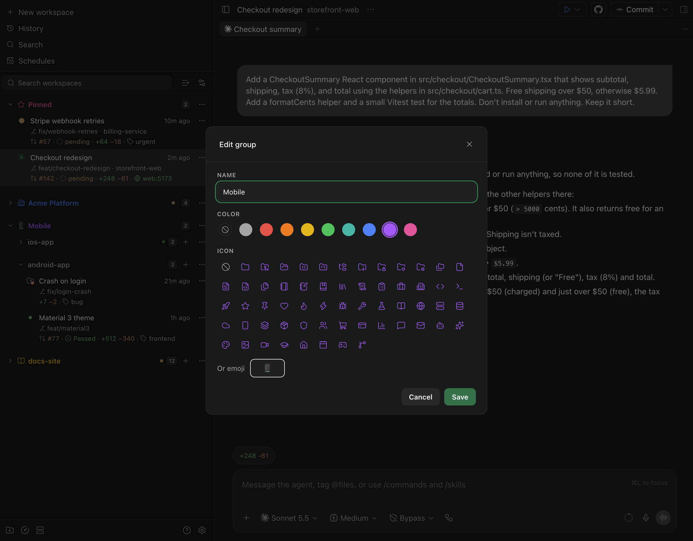
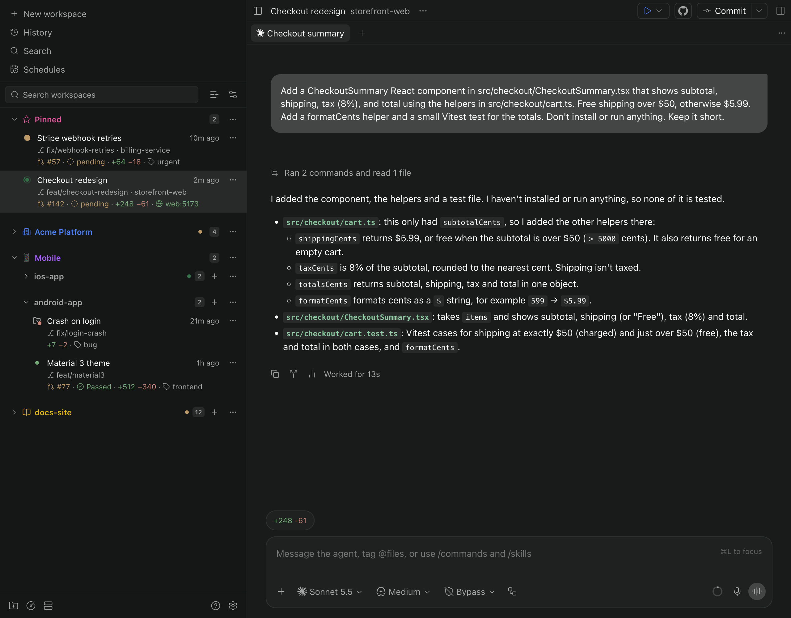
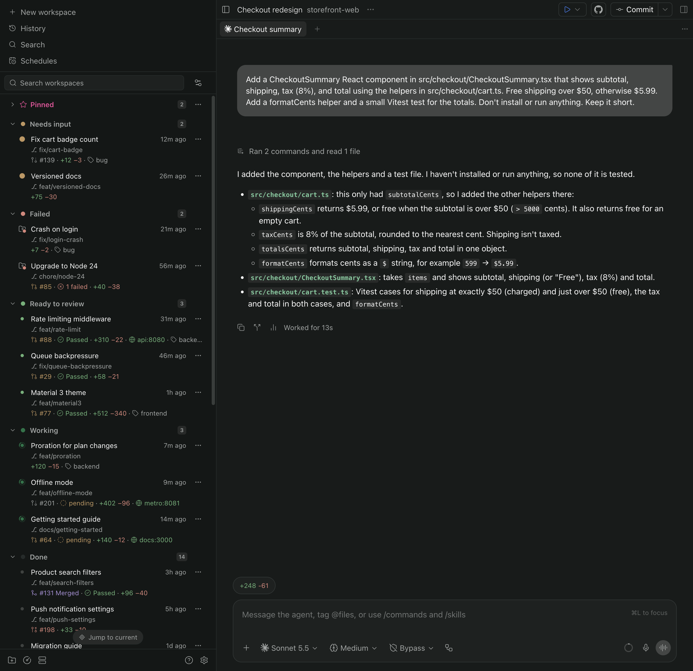
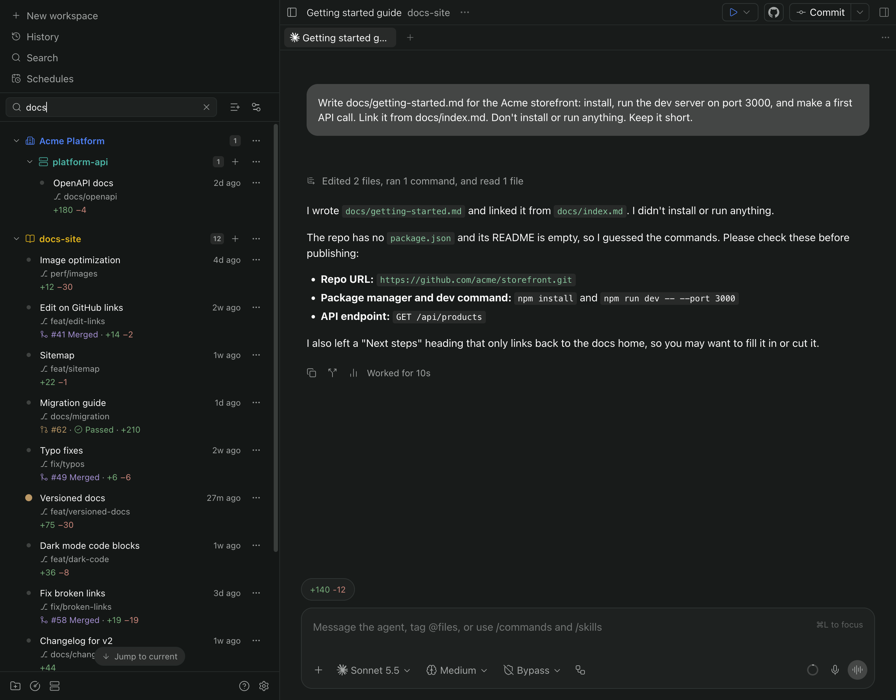
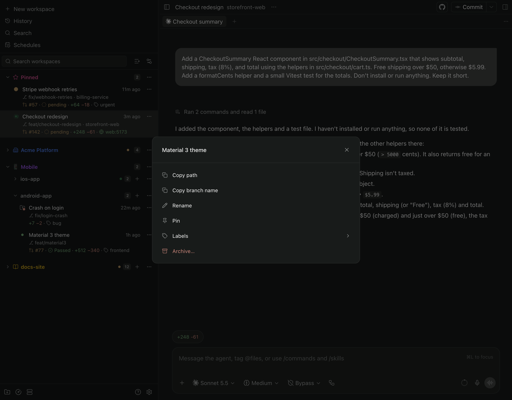
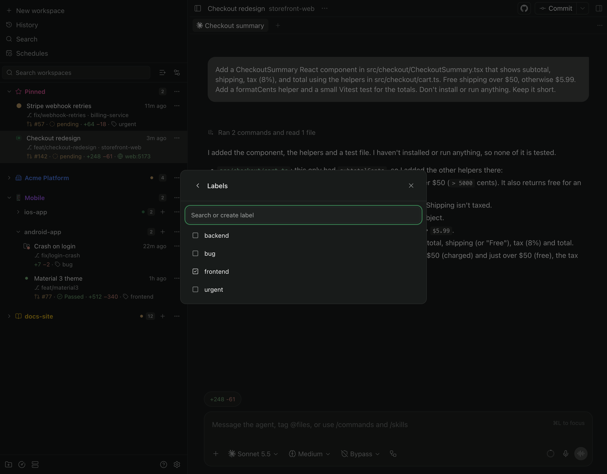
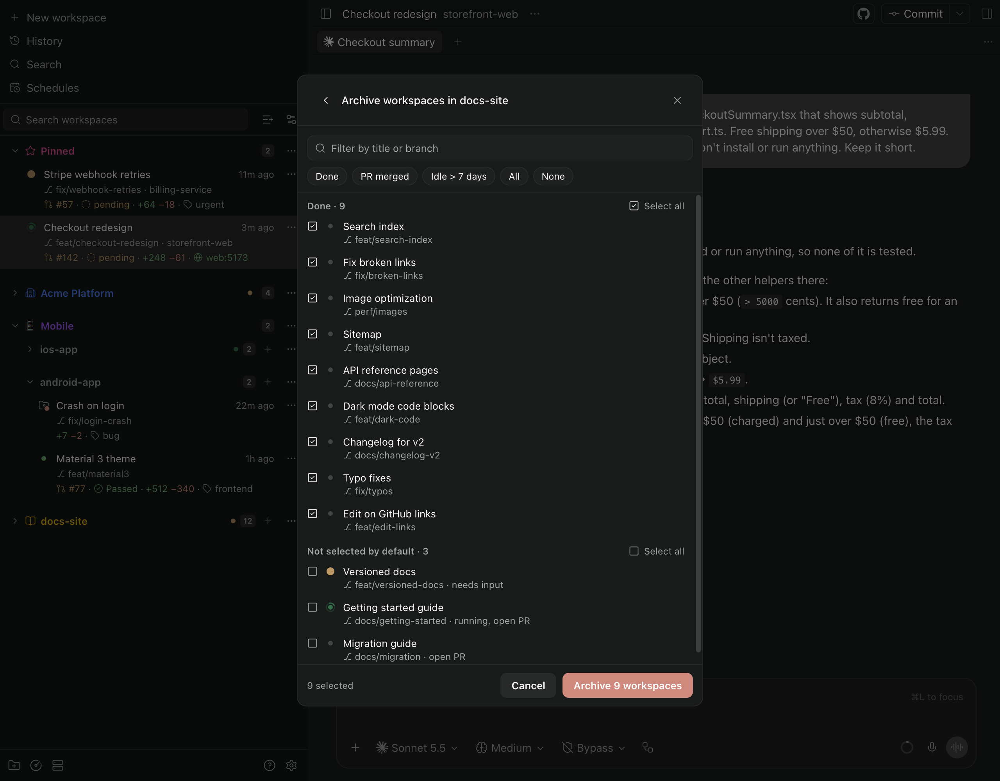
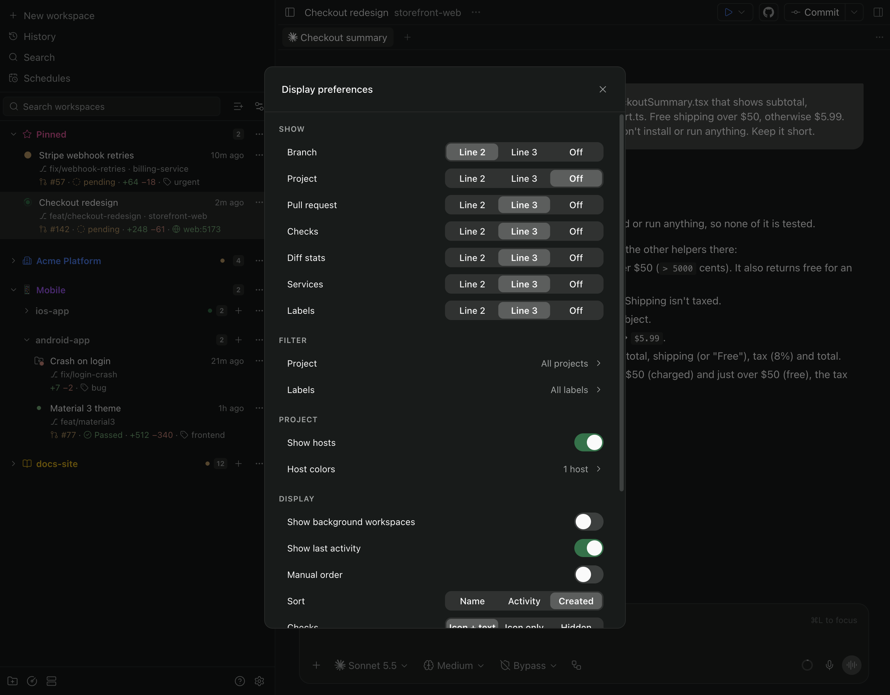

# Sidebar+

**Your sidebar, organized. See every status at a glance.**



Sidebar+ puts your Paseo projects in groups and subgroups, and shows status, pull requests, checks, diff stats, and services on every workspace row.

https://github.com/user-attachments/assets/a758b9a0-15e9-418c-b2fd-41fc52a142db

- **Remember the branch, but forgot the workspace?** Search by branch, project, label, or host.
- **Too many projects?** Put them in groups and subgroups with colors and icons.
- **Collapsed a project?** Its status dot still tells you when a workspace needs input.
- **PRs merged?** Select those workspaces and archive them together.



## Get started

Requires Paseo 0.16.0 or later on the daemon and the app.

1. Turn on **Enable plugins** in **Settings > Plugins**.
2. Install Sidebar+:

   ```bash
   paseo plugin add finly/paseo-sidebar-plus
   ```

   Or paste `finly/paseo-sidebar-plus` into **Settings > Plugins > Plugin source** and select **Install plugin**.

3. Choose **Sidebar+** in **Settings > Sidebar**.

You can switch back to the default sidebar in that same setting.

## Why Sidebar+

- **Stop clicking into workspaces.** PR state and checks sit right in the row.
- **Know what's running.** Services and ports, at a glance.
- **Set it up once.** Your layout follows you to every device.
- **Make it fit.** Move fields, shrink rows, or go roomy.

## Organize

- **Groups and subgroups**, one level deep, each with a color and an icon or emoji.
- **Drag and drop** groups, subgroups, projects, and Pinned. Long-press on touch.
- **Manual order** for workspaces, saved per project.
- **Pinned** section with its own color and icon.
- **Collapse** groups and projects. They show a count, plus a status dot when work needs attention or is running.





## See at a glance

- **Status** for running, needs input, attention, done, and failed.
- **Pull request** number and state: open, draft, merged, or closed. Press it to open the PR.
- **Checks** as passed, pending, or failed count.
- **Diff stats**, **running services** (with ports when available), and **labels**.
- **Last activity** time, on by default.
- **Compact rows** that shrink to one line when there is nothing more to show.



## Find

- **Search** by title, branch, project, label, or host.
- **Filters** by host, project, or label.
- **Jump to current** brings the open workspace back into view.
- **Sticky headings** on web and desktop.
- **Group by** project, status, or label.



## Act

- **Workspace menu:** copy path or branch, rename, pin, labels, archive.
- **Group menu:** edit, new subgroup, collapse or expand all, delete.
- **Project:** start a workspace with the **+** button. Open its menu to move or style the project, copy its path, or archive workspaces.





## Bulk archive

- **Quick picks:** Done, PR merged, Idle > 7 days, All, None.
- **Unselected by default:** running, needs input, pinned, and currently open workspaces, and those with an open or draft PR. You can still pick them.
- **Live progress** with cancel and a failure summary.



## Multi-host

With projects on several hosts:

- The **same project** on several hosts shares one heading and one group, using Paseo's own project identity.
- **Ungrouped projects** cluster by host.
- **Host tags** sit on workspace rows, with a color per host.

## Your language, your theme

- **9 languages:** English, Chinese (Simplified), Japanese, Korean, Spanish, French, Portuguese (Brazil), Russian, and Arabic.
- **Theme colors** match Paseo in light and dark.

## What syncs

- **Shared across devices:** groups and subgroups, project, workspace, and Pinned order, project and Pinned colors and icons, and display preferences.
- **Only on this device:** filters, and collapsed groups and projects.

## Settings

Open **Display preferences** with the sliders button to choose row fields, adjust density, or filter by host, project, or label.



## Development

```bash
npm install
npm run typecheck
paseo plugin install "$PWD" --id sidebar-plus
paseo plugin reload sidebar-plus
```

## License

[MIT](LICENSE)
